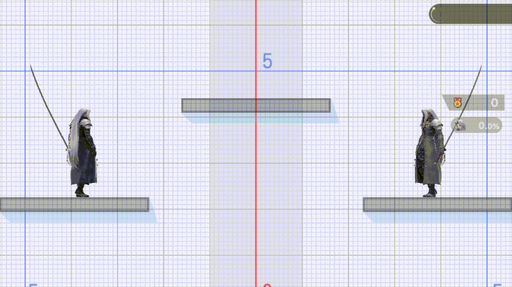
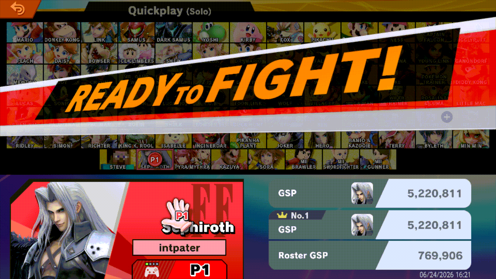

# quickplay-cancel-fix

> **Disclaimer:** this project was developed with the assistance of AI
> (Claude and other coding agents) under the operator's direction and
> review. Nothing is claimed beyond the dated tests cited below.

A Skyline plugin for Super Smash Bros. Ultimate 13.0.5. It gives you a
chance to leave a Quickplay match before it starts, from either side of the
room: as the host while the opponent loads in, and as the joiner for a few
seconds after you arrive. The Leave Battle tab, the dialog and the leave are
the game's own.

**Before** (joining a room, no plugin):



*Eden, 2026-11-11, run `qcf-shv1`, no plugin on either console. The console
has joined another console's room from the character select. Both players
are "Ready!" as soon as the waiting area appears, and "Get Ready" comes at
once. Pause, pressed four times, opens nothing, and the match starts with
no way out.*

**After** (joining a room, the 3 s hold):



*Eden, 2026-11-10, run `qcf-xhd4` row `h3l`, 0.3.0 release build
(`d69f11cf…`) with the default hold. The same join and the same presses.
The console stays "Preparing…", so the room never reaches "Get Ready". Yes
leaves, and the load back to the character select starts.*

## What it does

- **As the host** (you wait, an opponent joins): the lobby you enter from the
  character select lets you leave while the opponent loads in (Pause, Leave
  Battle, Yes), as the lobby after a "Rematch?" Yes already does.
- **As the joiner** (since 0.3.0): your console says "Ready!" a few seconds
  later than usual (3 by default). Meanwhile the opponent sees you as
  "Preparing…" and Pause has Leave Battle. Then the match starts as usual.
- **Names:** the opponent's name shows instead of "???".
- **Quickplay only:** local wireless, other online modes and offline play are
  left alone.

How it does this, and what it changes in the game:
[docs/HOW-IT-WORKS.md](docs/HOW-IT-WORKS.md).

## Tested

[Evidence](docs/EVIDENCE.md): Eden, 2026-11-10, 13.0.5 over LAN Online, two
consoles, one with the plugin.

- **Joining, held 3, 6 and 10 s:** Pause showed Leave Battle and the
  opponent's name 1.2–1.6 s after the waiting area appeared. Leaving went
  back to the character select 4 of 4 times; with no leave the match started
  after the hold, with no kick or time-out.
- **Matches after a hold**, a rematch after a held match included, played
  to their end on both consoles with no desync.
- **Hosting from the character select** (0.2.1): Leave Battle while the
  opponent loaded, Yes back to the character select, and the rematch match
  after it played to its end.
- **On a Switch:** 0.2.1 was installed and played on the operator's console
  on 2026-11-10 (its release `manifest.json`). 0.3.0 has been on that card
  since 2026-11-10 23:55Z, with `hold_seconds=5`; as of 2026-11-13 no play
  of the hold is recorded, and v0.3.0 is still a Forgejo pre-release.

## Install

Copy `libquickplay_cancel_fix.nro` to
`sd:/atmosphere/contents/01006A800016E000/romfs/skyline/plugins/`, from
[v0.3.0](https://git.syntaxbyexample.com/intpa/quickplay-cancel-fix/releases/tag/v0.3.0)
(pre-release, the joiner's hold) or
[v0.2.1](https://git.syntaxbyexample.com/intpa/quickplay-cancel-fix/releases/tag/v0.2.1)
(the host side and the names, no hold). The install line goes to
`sd:/ultimate/quickplay-cancel-fix/events.log`.

## Settings

`sd:/ultimate/quickplay-cancel-fix/config.ini` (optional):

```ini
hold_seconds=5
```

- How long a joined Quickplay match holds your "Ready!": 0.5 to 10 seconds
  (values outside are clamped). `0` turns the hold off.
- **Recommended: 5.** Without the file the hold is 3 s, which leaves about
  3 s for Pause, Up, A, Right, A (see Known limits).
- The file is read each time you join a match, so a change applies to the
  next one.

## Known limits

- **The hold runs while the menu is open.** With the default 3 s, Pause, Up,
  A, Right, A has to be done within about 3 s of the waiting area appearing.
  `hold_seconds=5` gives room for it.
- **A hold always ends:** after the configured time, a started round or a
  leave, or after 10 s in which the menu couldn't open. So the host never
  waits on it for more than the hold plus 10 s.
- **The loading screen itself can't be left.** The game opens the menu only
  once the waiting area is up, and a press during the black loading screen
  isn't remembered.
- **The install line** ends `other_hook=member_test`. That's the plugin's own
  name hook overlapping a code check, not another plugin.

## Build

```text
cargo test
cargo skyline build --release
```

The NRO is `target/aarch64-skyline-switch/release/libquickplay_cancel_fix.nro`.
`--features diag` builds the Eden diagnostic NRO (one log line per change).

## License

MIT
